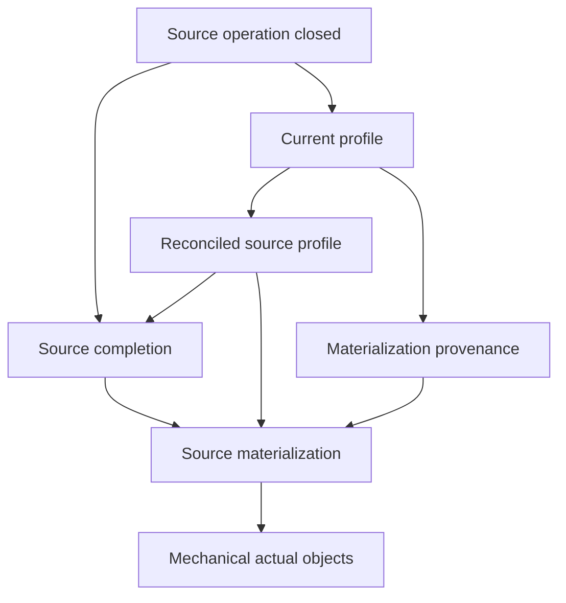

# Bounded integrated 06/07 assessment

**No new deterministic 06/07 blocker found in the reviewed source.** This is an internal writer counter, read-only, with no database, SQL execution, Native execution or product edit by this reviewer. Initial findings were locked to root before receiving another reviewer's 06/07 conclusions. Exact reviewed file hashes are in `INITIAL_ASSESSMENT.json` and `FINAL_SOURCE_RECHECK.json`.

The initial composition warning was real for those earlier bytes: old frozen EMPTY overlays would replace evolved source branches or refuse old predecessor pins. Root subsequently regenerated the fourteen overlays from explicitly revised source pins. The current read-only rebuild and declaration checks pass; the entire evolved base body, including source branches, is preserved under each additive EMPTY prefix. This resolves that source-composition warning. It does not establish Native63 behavior.

## Actual source checks

| Contract | Observed source | Assessment |
|---|---|---|
| Freeze all families before posting | `06_source_coordinator.sql:29–51` builds every closed8 manifest entry; `58–91` inserts every plan/component/part/support/sidecar; only `146–149` invokes the poster after the store returns. | No one-family-at-a-time posting gap. Request ordinals follow the normalized family loop; numeric family_ordinal matches 04/05. |
| Canonical6 and exact counts/hash | Store uses `source_adjustment_kernel_v1`, component count from k.components, total part count from entry.parts, and the identical flattened `{id,component_id,ordinal,amount}` part hash expected by 05. Full8 remains in full_family_result. | No full8-versus6 comparison found. Mechanical split sign/order/boundary are rechecked by 05 before Native posting. |
| Exact complete affected family set | Store ends by calling both `assert_source_operation_plan_set_v1` and `source_adjustment_fresh_v1`; 05 compares affected family IDs to operation sidecars and all manifest/actual actor-request plan IDs. | Unsupported family or missing/extra plan refuses before the first part. |
| Zero difference | Empty manifest creates no plans and skips poster loop. Materializer computes actual new objects, creates a financial marker only when nonempty, and always creates the immutable source-operation materialization. | Legitimate zero reconciliation still requires actual Native source proof and eventual completion. No fake zero J/plan/marker is needed. |
| Public reader before Native E | Materialization and all actual financial facts exist before Native's E calculation. The current source route selects immutable source materializations; 04 may use recorded N when no completion exists. | No pending work, q.response, active plan or live permission bypass is used as committed financial facts. Final status/outer receipt remain later obligations. |
| Terminal source | 06 passes the actual inverse UUID to the Native header predicate, compares raw source/physical/HPP fields except the separately proven sale/header support change, then stores completion. | No proof-JSON/UUID mismatch remains in the reviewed call. Existing first-FOUND class refusals remain scope limits. |
| Finish while q is pending | `source_request_finish_v1` checks work/current authority, NATIVE_COMPLETE, exact final source and absent execution/post scope, calls historical-capable completion proof, then deletes work. | It correctly does not call the final q.response/scopes closure before apply_command returns. |
| Exact outer receipt | 07 reconstructs status/row_version from saved final Native Z, then includes exact action/request/source IDs and REVERSED source status. | It validates the historical receipt, not today's sale version/status. |
| Historical raw AR | 07 derives saved net/P from c.final_native_source and saved I/U from c.final_profile. Native journal IDs come from that saved source; recognition journals are limited to saved profile PART_JOURNAL IDs. | Later Native inverse or ADJ journals cannot leak into the earlier completion's raw-AR sum. |
| Future operation history | 04 uses explicit operation_ordinal/predecessor and historical plan IDs, reconstructs B/N input and historical old-object prefixes; completion expects saved old objects plus exactly that operation's own objects. | No current-stock/cache equality is substituted for historical source proof. Latest source/profile is checked separately. |
| Deferred both INSERT and UPDATE | 07 attaches DEFERRABLE INITIALLY DEFERRED triggers to work/materializations/plans/completions/part seals, for INSERT or UPDATE; mutable work operation-ID changes check both old and new IDs. | Early work insertion cannot vanish silently without its immutable completion/real receipt at commit. Existing immutable triggers still forbid rewriting financial sidecars/seals. |
| Original credit fact closure | Evolved coordinator06 routes source-owned financial markers and plan descendants to source closed verification. Regenerated EMPTY prefix preserves both routes. | New ADJ/support/component/part/J rows retain their original owning-fact trigger coverage. Zero-diff is covered by the new source table triggers even though there is no financial marker. |

## Recursion check

The relevant call graph terminates in the mechanical object collector. That collector validates actual identities/components/parts/journals and calls `current_leaf_assignment`, whose source is table-only; it does not invoke the current financial reader or owning closure.

`assert_source_completion_v1` calls `assert_source_materialization_v1`, which reaches `source_historical_objects_v1` and `current_materialized_objects`; none calls `assert_source_operation_closed_v1` or `assert_current_materialized_profile`. The current-profile source branch can call completion, but completion returns through the mechanical path rather than back to current-profile. Native E uses the current profile; it does not enter deferred closure. Native EMPTY provenance delegates to its immutable member verifier, not to `assert_native_empty_closed_v1`; its own deferred closure may call the current reader without introducing a reverse edge from provenance to that closure.

No recursion or historical/live semantic conflation was found on these reviewed edges. This conclusion depends on keeping completion/materialization proof separate from the final outer-request closure exactly as the current source does.

## Focused expected sequences

These are source-derived contract controls, not newly executed tests. V1/V2 denote the actual Native inverse economic/book pairs and may be the same Jakarta day when both commands occur that day.

| Sequence | Historical/next expected | Closure implication |
|---|---|---|
| Paid1000, return200 CREDIT, RETURN_REVERSE | Own ADJ−200@V1; I0, P1000, net1000, E1000, AR0; stock6→5. | Initial J/cohort remain immutable; one source inverse and one actual ADJ. |
| Earlier ordinary refund0 return, later return200 CREDIT, reverse earlier zero return | Both families' differences empty; I200/E800/AR0 unchanged; stock7/70→6/60; one real Native HPP inverse, no new financial marker. | Immutable source materialization/completion and exact receipt are still required. Frozen fifth fixture covers this boundary when root executes it. |
| Two genuine payments900+100, initial return200 CREDIT; reverse payment100, then reverse return200 | After first: P900/I100/net800/E800/AR0, ADJ−100@V1. After second: P900/I0/net1000/E900/AR100, ADJ−100@V2. | Earlier c1 remains I100/AR0 with its PAID receipt; c2/current profile is I0/AR100/PARTIAL_PAID. Earlier proof must exclude the second ADJ and the second Native inverse. Current 07 filtering and 04 historical plan/object selection match that requirement. |
| Reverse return200 first, then reverse payment1000 | First I0/P1000/net1000/E1000/AR0 and PAID. Second has zero recognition difference, P0/I0/net1000/E0/AR1000 and POSTED. | Op2 must have ordinal2/predecessor op1 and completion with no fake new financial objects; op1 receipt/status/version remains its historical value. |

## Regenerated fourteen overlays

Read-only `build()` reproduced both current generated SQL and manifest exactly. Read-only `native_empty_bundle.declarations()` accepted all source/file hashes. Thirteen overlays retain the exact complete evolved predecessor body as a suffix after a single additive outer-BEGIN prefix. The fourteenth is the pre-existing explicit `is_unchanged_native_return_v1=false` specialization. The generator's AST matches HEAD after excluding only the PINS assignment, so no builder algorithm change was found.

The generated final provenance body still calls `assert_source_materialization_v1`; the generated deferred router still contains both source-operation closure branches. Current generated SQL SHA: `bea5faafa415600a9b1973654fe6c0c4c449256ed8bb8fb8698a3ff62b026ad9`.

Root-owned compiler/pure-control results and the pending Native63 runtime gate are separate evidence. This counter does not promote source review or file-only declaration checks into Native execution, runtime transaction closure, browser proof or production approval.
